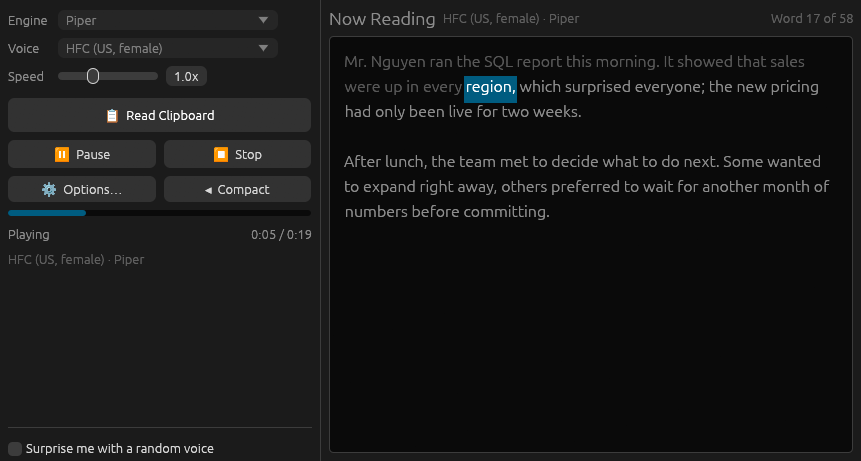
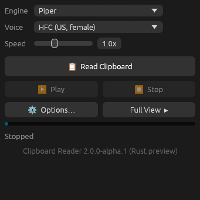
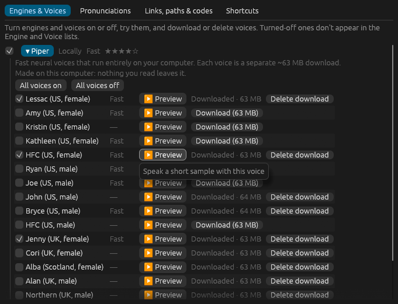
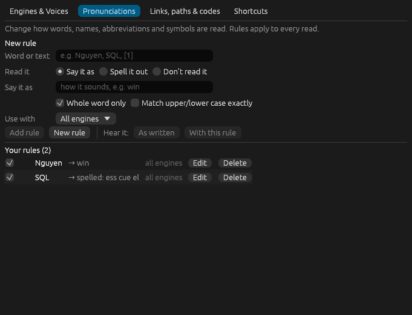
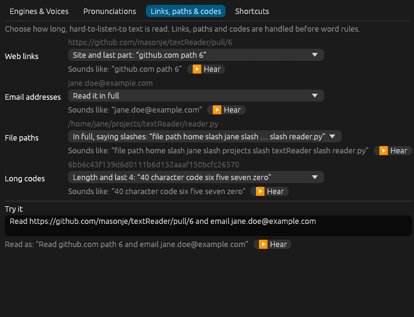

# Clipboard Reader (Rust)
Reads text aloud. This is the Rust version of [Clipboard Reader](https://github.com/masonje/textReader), a take on TextAloud MP3 made for Linux. It's one program with no Python, `.venv` or PyInstaller, and about a quarter of the size of the Python build (about 50 MB instead of 187 MB). It's tested on Ubuntu with an X11 desktop; see [Tested Platforms](#tested-platforms).

**Version:** 2.0.0-alpha.1 — see [Changelog](#changelog) for what changed in each version.



## Why I Built This
I love Linux, but I've struggled with dyslexia my whole life. Having text read aloud is how I get through long emails, documentation and web pages. On Windows I used TextAloud MP3, and on the Mac I used the built-in speech features, but on Linux I couldn't find anything that did what I needed.

So I made my own. Copilot helped me get it started, and Claude helped me turn it into the tool I actually need. Clipboard Reader is what lets me live in Linux on both my work and home machines.

The first version is written in Python. This Rust version does the same job as a single fast program, and is being built in stages until it does everything the Python one does (see [Status](#status)).

## Screenshots

**Compact view**: just the controls, small enough to leave on screen. (The **Full view**, shown at the top, adds the text being read with the current word highlighted, plus Surprise me.)



**Options** (the **Options…** button) has four tabs:

**Engines & Voices**: turn engines and voices on or off, preview them, download or delete voices, and see where audio is generated, speed and quality.



**Pronunciations**: change how words, names, abbreviations and symbols are read.



**Links, paths & codes**: read long web links, email addresses, file paths and codes in a short form instead of spelling them out.



The fourth tab, **Shortcuts**, sets the keyboard shortcuts.

## Status

| | |
|---|---|
| ✅ Engines | Piper (offline, downloadable voices), Edge TTS, gTTS, eSpeak-NG |
| ✅ Playback | mpv, with speed changes while reading |
| ✅ Views | Compact and Full, with word highlighting in the Full view |
| ✅ Options | Engines & Voices, Pronunciations, Links/paths/codes, Shortcuts |
| ✅ Shortcuts, tray icon, Surprise me | as in the Python version |
| ⏳ Stage 3 | Festival, system voices (pyttsx3), Coqui, Windows and macOS builds |

Not in this version yet: Debug mode, a theme setting, per-voice star ratings and voice details, right-clicking a selection of several words, and the beep when there's nothing to read.

## Features
- **Pronunciations:** change how words, names, abbreviations and symbols are read aloud (Options… → Pronunciations, or right-click a word in Now Reading). See [Pronunciations](#pronunciations).
- **Links, paths & codes:** long web links, email addresses, file paths and codes (hashes, keys, account numbers) are read in a short form you choose, like "github.com path 6" or "40 character code six five seven zero". See [Links, paths and codes](#links-paths-and-codes).
- **Surprise me:** tick "Surprise me with a random voice" (Full view, bottom left) and each read uses a random voice from the engines and voices you have turned on. Voices that would need a download first are skipped, and the same voice isn't picked twice in a row. Now Reading shows which voice was used. If the picked voice fails (for example, an online service doesn't answer), another engine is tried automatically.
- Two views: **Compact** (just the controls, small enough to leave on screen) and **Full** (adds a panel showing the text being read, with the current word highlighted). Switch with the Full View ▸ / ◂ Compact button.
- Reads the selected text, or the clipboard if nothing is selected
- Adjustable playback speed (0.5x–2x), which can be changed while reading without restarting it
- A **Building Audio** window with progress and **Cancel** while the audio is made (shown after a moment, so quick reads don't flash it)
- System tray icon with Read Clipboard, Stop and Quit
- Configurable keyboard shortcuts that work from any program (Options… → Shortcuts). Hover over Read Clipboard, Play, Pause or Stop to see its shortcut.
- Shares settings, downloaded voices and pronunciation rules with the Python version

## Requirements

- Linux with an X11 desktop session (Wayland isn't supported yet: the shortcuts and selection reading use X11)
- libmpv: plays the audio and lets the speed change while reading
- libespeak-ng: Piper uses it to turn text into sounds
- xclip: reads the selected text and the clipboard
- espeak-ng (for the eSpeak-NG engine) and ffmpeg (for more accurate word highlighting), both optional
- To build it: Rust, from [rustup.rs](https://rustup.rs) (no sudo needed)

On Ubuntu/Debian:

```bash
sudo apt install libmpv2 libespeak-ng1 xclip espeak-ng ffmpeg
```

These are already installed if the Python version works.

### Tested Platforms

| Platform | Status |
|---|---|
| Ubuntu 26.04 with MATE (X11) | ✅ Tested. |
| Debian and other Ubuntu-based systems with X11 | Should work, with the packages above. |
| Fedora, Arch (X11) | ⚠️ Not tested. Should work with their libmpv, espeak-ng and xclip packages. |
| Wayland sessions | ❌ Not yet. Log in to an X11 session (often "Xorg" on the login screen). |
| macOS, Windows | ❌ Not yet. Planned for stage 3. Use the [Python version](https://github.com/masonje/textReader) there. |

If you try it on an untested platform, please open an issue saying whether it worked.

## Installation

```bash
git clone https://github.com/masonje/textReader-rust.git
cd textReader-rust
scripts/install.sh
```

This builds the program and installs it for your user only (no sudo). The program goes in `~/.local/bin/clipboard-reader`, and **Clipboard Reader (Rust)** is added to your app menu with its icon. The first build takes about 6 minutes, because it downloads ONNX Runtime (for Piper voices) and builds it into the program. If Rust or a package the app needs is missing, the script says what to install.

Run the script again to update. To remove it (your settings and voices stay):

```bash
scripts/install.sh --uninstall
```

It doesn't replace the Python version's `reader`. **Run one version at a time:** if both are running, both answer the shortcuts, and the Python version can overwrite settings the Rust one saved.

## Using It

Select or copy some text and press the read shortcut (**Win+Esc** by default), or click **Read Clipboard**. Use **Play**, **Pause** and **Stop** to control it, and the **Speed** slider (0.5x–2x) to change speed, even while it's reading. **Engine** and **Voice** are locked while audio is being built or played; press Stop to change them.

### Keyboard Shortcuts
- **Win+Escape** — Read selected text
- **Win+Shift+R** — Resume/Play
- **Win+Shift+P** — Pause
- **Win+Shift+S** — Stop

Change them in **Options… → Shortcuts**: type them like `Win+Shift+R`, `Ctrl+Alt+P` or `Win+Esc`, then **Save**. They work straight away. Resting the mouse on the Read Clipboard, Play, Pause or Stop button shows its current shortcut.

The app notices shortcuts without taking the keys away from other programs (as the Python version does), so the Win key's own menu can't block them, and the keys still reach the window you're in.

### Checking the Version
- The Compact view shows the version at the bottom of the window.
- From a terminal: `clipboard-reader --version`.

## Speech Engines

Pick the engine and voice in the main window. Each engine remembers its own voice choice.

The **Engines & Voices** tab of **Options…** lists every engine and voice:
- **Generated:** "Locally" means the speech is made on your computer and nothing you read leaves it (Piper, eSpeak-NG). "Online (Google)" for gTTS and "Online (Microsoft)" for Edge TTS mean the text you read is sent to that company's servers, which return the audio. Piper downloads each voice once but then runs offline.
- **Speed** is measured, not guessed. Every read (and every Preview) records how long the voice took to build compared with how long the speech is. Hover over a voice's speed to see "about 8 s to build 1 minute of speech". Builds that include a one-time download or model load are skipped.
- **Quality** shows a typical rating for each engine.
- **▶ Preview** speaks a short sample with that voice. If the voice isn't downloaded yet, it downloads first.
- **Downloaded voices** (Piper) show their size on disk and have a **Download** button with progress and Cancel, or a **Delete download** button that frees the space (the voice downloads again next time it's used). Downloads keep going if you close the window.
- **On/off:** tick or untick an engine or voice. Turned-off ones disappear from the Engine and Voice drop-downs. **All voices on** and **All voices off** act on that engine. At least one engine, and one voice per engine, always stays on.

These are saved in settings.json as `disabled_engines`, `disabled_voices` and `voice_stats`, the same as the Python version.

| Engine | Voices | Quality | Needs |
|---|---|---|---|
| [Piper](src/engines/piper.rs) | 15 English voices (US, UK, Scottish; male and female) | Natural neural voices, offline | Each voice is ~63 MB, downloaded the first time it's used (or from Options… → Engines & Voices) to `~/.textReader/voices/piper`; libespeak-ng |
| [Edge TTS](src/engines/edge.rs) | ~47 English voices from Microsoft (US, UK, Australia, Canada, India, Ireland, and more) | Very natural neural voices | Internet connection |
| [gTTS](src/engines/gtts.rs) | 8 English accents (US, UK, Australia, Canada, India, Ireland, South Africa, Nigeria) | Good | Internet connection |
| [eSpeak-NG](src/engines/espeak.rs) | English accents, plus female variants of US and UK English | Robotic | `espeak-ng` |

Festival, pyttsx3 (the system's voices) and Coqui TTS are coming in stage 3.

Run `clipboard-reader --check-engines` to see which engines work and try each one.

## Pronunciations
Open the **Pronunciations** tab of **Options…**, or right-click a word in Now Reading and choose **Change how "word" is read…** (or **Edit…** if it already has a rule). Each rule matches a word, name, letters or symbol and does one of:

| Option | Example |
|---|---|
| **Say it as** — type how it sounds | Nguyen → "win", GIF → "jif", Rx → "prescription" |
| **Spell it out** letter by letter | SQL → "ess cue el" |
| **Don't read it** | footnote markers like `[1]` |

Options per rule: **Whole word only** (on by default, so "cat" doesn't change "concatenate"; symbols such as `&` or `[1]` still match next to a word), **Match upper/lower case exactly**, and **Use with** all engines or just one. Tick a rule's box to turn it on or off. **Hear it: As written / With this rule** plays the word with your current voice so you can compare before saving. Your rules are listed under the editor.

Rules apply to every read (including Surprise me). Now Reading still shows your original text, and word highlighting is timed to what is actually said. The terminal shows the text sent to the voice whenever rules or filters changed it. Rules are applied in one pass, longest first, and are saved as `pronunciations` in settings.json. The logic is in [pronunciation.rs](src/pronunciation.rs), and its tests check it reads 397 sample texts exactly as the Python version does.

### Links, paths and codes
The **Links, paths & codes** tab of **Options…** chooses how long, hard-to-listen-to text is read. Each row shows an example, what it will sound like, and a **▶ Hear** button. The **Try it** box shows how any text you paste will be read (word rules included) and can play it.

| Kind | Options (first is the default) |
|---|---|
| **Web links** | Site and last part: "github.com path 6" · Site and "weblink": "github.com weblink" · Just say "link" · Read it in full |
| **Email addresses** | Read it in full · Just the name before the @: "jane doe" · Email to the name: "email to jane doe" · Just say "email address" |
| **File paths** | Folder and file: "path slash textReader slash reader dot py" · File path: "file path slash textReader slash reader.py" · Say the file name: "path to reader.py" · Just say "file path" · In full, saying slashes: "file path home slash jane slash … slash reader.py" · In full, no slashes: "file path home jane … reader.py" |
| **Long codes** | Length and last 4: "40 character code six five seven zero" (or "16 digit code …" for numbers) · Say the first 4: "code six bee bee six" · Just say "code" · Read it in full |

What counts:
- **Web links** start with `http://`, `https://`, `ftp://` or `www.`. Punctuation that ends a sentence isn't part of the link, and the query (`?…`) is ignored.
- **File paths** start with `/` and have at least two parts, or start with `~/`, `./`, `../` or a drive letter like `C:\`. So "and/or" and "1/2" are left alone.
- **Long codes** are 12 or more letters and digits run together with at least 2 digits, optionally joined by `-` or `_`: git hashes, UUIDs, tracking numbers, licence keys, card and account numbers. Dates and phone numbers aren't long enough to count.

Links, paths and codes are handled before word rules. The choices are saved as `text_filters` in settings.json.

## Word Highlighting (Full view)
None of the speech engines report when each word is spoken, so [word_timing.rs](src/word_timing.rs) estimates it, the same way as the Python version (its tests check the results match):
1. Each word is weighted by length, with extra time after punctuation where voices pause.
2. ffmpeg's `silencedetect` finds where speech starts and ends and the pauses in between.
3. Pauses are matched to the punctuation they belong to, which keeps long text from drifting.

Highlighting starts at once with an even estimate, and becomes more accurate a moment later when ffmpeg has found the pauses. Without ffmpeg it stays with the estimate. Sentence starts usually land within about 0.1 s of the real audio; within a sentence, the highlight can run slightly ahead of or behind the voice. It follows the speed setting, and scrolls to keep the current word in view.

## Settings
Settings are saved in `~/.textReader/settings.json`, the same file the Python version uses. When the Rust version saves a setting, it changes only that key, so settings that only the Python version uses (like `theme` and `debug_mode`) are kept. The **Shortcuts** tab of the **Options…** window sets the shortcuts. The same values can also be edited directly in JSON:

```json
{
	"playback_speed": 1.0,
	"tts_engine": "Piper",
	"voices": {"Piper": "en_US-hfc_female-medium", "gTTS": "com"},
	"view_mode": "compact",
	"full_window_size": "",
	"surprise_voice": false,
	"pronunciations": [
		{"text": "SQL", "mode": "spell", "say": "", "whole_word": true, "match_case": false, "engine": "", "enabled": true},
		{"text": "Nguyen", "mode": "say", "say": "win", "whole_word": true, "match_case": false, "engine": "", "enabled": true}
	],
	"text_filters": {"urls": "site_end", "emails": "full", "paths": "tail", "codes": "length"},
	"hotkeys": {
		"read_selected_text": "Win+Esc",
		"play": "Win+Shift+R",
		"pause": "Win+Shift+P",
		"stop": "Win+Shift+S"
	}
}
```

`view_mode` is `"compact"` or `"full"`, and `full_window_size` remembers the Full view's size (for example `"860x460"`). Both are saved automatically.

## Troubleshooting

**Start it from a terminal** to see what it's doing: `clipboard-reader`. It prints the shortcuts it's using, what it reads, which engine built it and how long that took, and any errors.

**Command-line options:**

| Option | What it does |
|---|---|
| `--version` | Print the version and exit. |
| `--check-engines` | Speak a short phrase with every engine and report which work and why the others don't. The quickest check after installing or updating. |
| `--options=<tab>` | Open Options on a tab at start-up (`engines`, `pronunciations`, `filters` or `shortcuts`). |

**Messages to look for:**

| Message | Meaning |
|---|---|
| `⌨ read_selected_text` (or `play`, `pause`, `stop`) | A shortcut was pressed and recognized. |
| `🎲 Surprise voice: …` | Surprise me picked this voice. |
| `Built in 2.3s with Piper` | The audio was made, and how long it took. |
| `✖ Cancelled audio build` | Cancel was pressed in the Building Audio window. |
| `❌ libmpv not found (install libmpv2)` | The app can't play audio. Install libmpv (see [Requirements](#requirements)). |
| `⚠️ No text to read: select or copy some first.` | Nothing was selected and the clipboard was empty. |
| `⚠️ The clipboard didn't answer …` | The program you copied from didn't respond within 2 seconds. Copy again. |
| `⚠️ Keyboard shortcuts aren't available: …` | The shortcuts couldn't start, usually because this isn't an X11 session. The buttons and tray still work. |

**Shortcuts don't do anything:** check that the terminal prints a `⌨` line when you press one. If it doesn't, check you're in an X11 session (`echo $XDG_SESSION_TYPE` should say `x11`) and that the Python version isn't running too.

**Playback problems:** start it with an mpv log, reproduce the problem, and include the log in your report:

```bash
TR_MPV_LOG=/tmp/mpv.log clipboard-reader
```

**Reset settings:** quit the app and rename `~/.textReader/settings.json`. It starts with the defaults and makes a new one. Downloaded Piper voices (`~/.textReader/voices`) are kept. This resets the Python version's settings too, since they share the file.

**An engine is missing from the list:** it may be turned off in **Options… → Engines & Voices**, or missing something it needs. `--check-engines` says which.

## Contributing

Building from source, how the code is laid out, running the tests, adding a speech engine, and debugging tools are in [CONTRIBUTING.md](CONTRIBUTING.md).

## Changelog

The version number is in [Cargo.toml](Cargo.toml). Versions continue from the Python version's 1.11.0; 2.0.0 will be the first release that does everything the Python version does.

### 2.0.0-alpha.1 — 2026-11-19
The first Rust version, built in stages.

**Stage 2:**
- **Added:** Full view: the text being read, with words already read dimmed, the current word highlighted, and "Word N of M". Word timing is a port of the Python version's and its tests check the results match.
- **Added:** Right-click a word in Now Reading to add or edit its pronunciation rule.
- **Added:** Surprise me with a random voice, trying another engine if one fails.
- **Added:** Building Audio window with progress (including voice downloads) and Cancel.
- **Added:** Options window: Engines & Voices (on/off, Preview, download/delete, measured speed), Pronunciations, Links, paths & codes (with Try it), and Shortcuts.
- **Added:** Pronunciation rules and the links/paths/codes filters apply to every read. Their tests check 397 sample texts are read exactly as the Python version reads them.
- **Added:** `scripts/install.sh` installs the app for your user with an app-menu launcher and icon; `--uninstall` removes it.
- **Changed:** Shortcuts notice key presses without grabbing the keys, like the Python version, so they work on desktops whose Win-key menu (such as MATE's) would otherwise block them.
- **Changed:** In Pronunciations, the list of rules is under the editor.

**Stage 1:**
- **Added:** Piper (same voices and downloads as the Python version), Edge TTS, gTTS and eSpeak-NG engines.
- **Added:** mpv playback with speed changes while reading; Play, Pause, Stop.
- **Added:** Compact view, global keyboard shortcuts from your settings, and a tray icon.
- **Added:** Shares `~/.textReader/settings.json` with the Python version, changing only the keys it saves.
